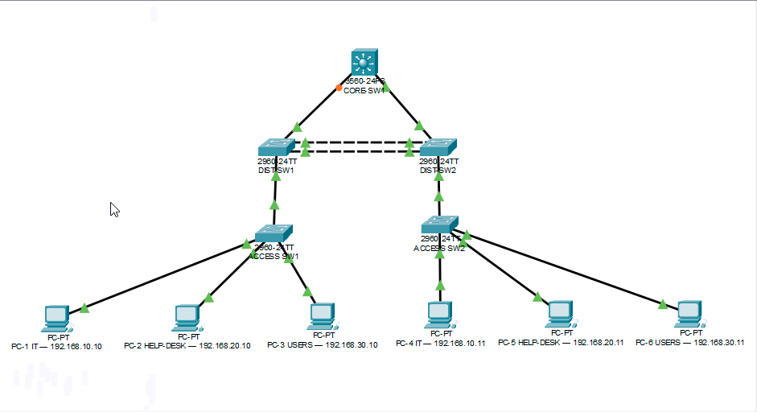

# Enterprise Network Lab

## Project Overview

Built and configured a multi-layer enterprise network using Cisco Packet Tracer. This project demonstrates practical networking skills through VLAN segmentation, inter-VLAN routing, DHCP, network redundancy, switch security, and troubleshooting.

## Network Topology

The network uses a three-layer architecture:

- **Core:** Cisco 3560 multilayer switch
- **Distribution:** Two Cisco 2960 switches
- **Access:** Two Cisco 2960 switches
- **End Devices:** Six PCs

## Technologies and Skills

- VLANs and network segmentation
- 802.1Q trunk configuration
- Inter-VLAN routing using Switch Virtual Interfaces (SVIs)
- DHCP configuration and address assignment
- Spanning Tree Protocol (STP)
- LACP EtherChannel
- SSH remote switch management
- Port security with sticky MAC addresses
- Unused switchport shutdown
- Password encryption and MOTD banners

## IP Addressing Plan

| VLAN | Department | Network | Default Gateway |
|---|---|---|---|
| 10 | IT | 192.168.10.0/24 | 192.168.10.1 |
| 20 | Help Desk | 192.168.20.0/24 | 192.168.20.1 |
| 30 | Users | 192.168.30.0/24 | 192.168.30.1 |

## Troubleshooting Scenarios

### 1. VLAN Assignment Failure
- Identified an incorrectly assigned access VLAN.
- Inspected switchport configuration.
- Corrected the VLAN assignment.
- Verified gateway connectivity.

### 2. DHCP Failure
- Inspected DHCP pools and address bindings.
- Identified a missing VLAN 10 DHCP pool.
- Recreated the DHCP pool.
- Renewed the client address and verified connectivity.

### 3. Trunk Configuration Failure
- Inspected trunk interfaces and allowed VLANs.
- Identified VLAN 10 missing from the allowed VLAN list.
- Restored the trunk configuration.
- Confirmed connectivity after the correction.

## Network Verification

Verified:
- DHCP address assignment across all three VLANs.
- Same-VLAN connectivity.
- Inter-VLAN connectivity.
- Default gateway reachability.
- LACP EtherChannel operation.
- STP redundant-link behavior.
- Port security enforcement and recovery.

Final ping tests achieved 4 successful replies with 0% packet loss across the tested VLAN connections.

## Project Files

- `Enterprise_Network_Lab_Final.pkt` — Cisco Packet Tracer project file.
- `Network-Topology.png` — Network topology diagram.

## Project Purpose

The goal of this lab was to develop hands-on experience configuring, securing, verifying, and troubleshooting a segmented enterprise network.

## Project Evidence

The following folders contain screenshots documenting the network configuration, testing, and troubleshooting.

| Section | Evidence |
|---|---|
| VLAN Configuration | [View VLAN screenshots](screenshots/vlan/) |
| Trunking | [View trunking screenshots](screenshots/trunking/) |
| Inter-VLAN Routing | [View routing screenshots](screenshots/routing/) |
| DHCP | [View DHCP screenshots](screenshots/dhcp/) |
| EtherChannel and STP | [View EtherChannel and STP screenshots](etherchannel-stp/) |
| Network Security | [View security screenshots](screenshots/security/) |
| Troubleshooting | [View troubleshooting scenarios](screenshots/troubleshooting/) |
| Final Verification | [View final verification screenshots](screenshots/final-verification/)
